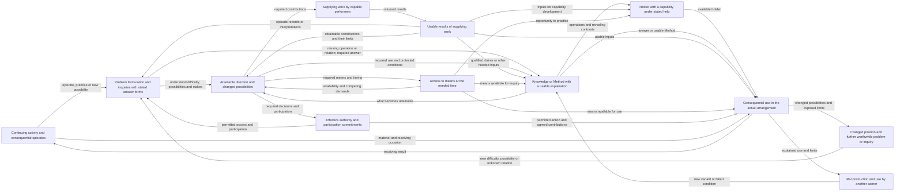

### C.40.OD:4 - Solution

Start with this recurrent situation: a subject can perform some worthwhile activity, but its current way does not let it formulate or accomplish a further worthwhile change. Its difficulty can be visible only in interruptions, dependence on a particular helper, repeated exceptions, displaced costs or a possibility that it cannot yet use. Construct the connections among that subject, its continuing activity, and the knowledge and Methods that could change what it can obtain. Problem formulations guide inquiries and choices; performed work can return a usable result, change a subject's capability, or make further work possible. For each connection distinguish the work, its performer, what it changes or returns, and the conditions under which the receiving performer can use that result. Cultural continuation requires other carriers to reconstruct and use the Method. These are connected claims about different participants and results, not one object moving through a common sequence.

The construction below is prospective. It describes transformations to arrange and the contributions on which they depend. It does not assert an obtaining E.18.NET network or make the following descriptions an exhaustive taxonomy of flows. Use the direct E.18 identity and change rules when selecting actual flow members. One described strand can require several members; two distinctions useful for the explanation can belong to one member.

#### C.40.OD:4.1 - Identify the growth and its receiving continuation

Begin with a consequential situation, not an office proposal. Name the subject whose possibilities are in question, the work or life situations that matter to it, and the available basis for describing its current position. A person, team, organization, technical system and cultural population require different descriptions. A provider, a paying organization and a participant can coincide in one case and differ in another.

Use C.40.OI and C.40.OC to bound and characterize the development inquiry. B.5.PI supplies the entry from an unnoticed or weakly understood difficulty in ordinary work. C.40.PC and C.40.CD help construct the problem and possible contribution when neither is settled. A discrepancy from a target is one entry; a newly accessible possibility, a dependence that has become costly, a changed environment or an unexamined limit after success can be another.

For each intended change, say what the subject could subsequently do or obtain, why that is worth pursuing, what it could lose, and which uncertainty matters now. A slogan such as “become a learning organization” does not yet distinguish changes. Compare, for example, a team that can obtain a qualified answer from an adviser, a team that can make that judgement itself, and a team that can construct and improve its own way of making such judgements. These can all be useful; their costs and evidence differ.

Keep the present work that must continue visible. Development need not suspend useful operation, nor must every limitation be removed before the next contribution. Rest, consolidation, deliberate termination of one direction and protection from overload can preserve the conditions for subsequent development.

An epistemic question can supply the consequential situation. State what knowledge, understanding or way of obtaining results should grow and what new results or questions that growth could make attainable. A scientific explanation can be a worthwhile result before a practical application is found.

Distinguish three claims: the current result became better, the available way or understanding grew, and that growth changes which further problems can be handled. Explain each relied-on connection. A routine service improvement can end with the first claim; it need not be redescribed as open-ended development.

#### C.40.OD:4.2 - Formulate the problem and the inquiries needed to choose a direction

Keep ordinary work running where it remains useful. Preserve enough of a consequential episode to recover what was being attempted, the way used, its premises and what actually happened. The episode may be a failure, an unexpectedly successful response or a newly available means. Use a sufficient established account directly. When different live explanations would change the continuation, distinguish them before selecting the repair. For example, inability to supply a result can concern an inadequate Method, unavailable authority or an unlearned operation. Sending all three into a training programme would give them the wrong continuation.

Problematisation transforms the subject's understanding of the situation and produces a formulation of what is difficult or newly possible, why it matters, and which premise makes the current way insufficient. Use B.5.PI, C.40.OI, C.40.PC and C.40.CD to construct that formulation. Keep it distinct from the change eventually chosen and from a claim already established by inquiry.

When a needed contribution is an answer, use B.5.QD:4.3 to give the inquiry a recoverable answer form: name the objects, premises and allowed changes, and what would answer it. An explanation of an observed relation, a workable construction and a bound on an unknown quantity can require different work. An ordinary question is adequate when its subject and required answer are clear; it need not receive a new formal type. A choice of which worthwhile change to pursue can depend on such answers without being settled by them.

The formulation and available answers supply two different receiving operations:

- Direction construction compares worthwhile attainable changes for the subject, including their means, losses and dependence on others' contributions. It uses the understood difficulty and known possibilities, and identifies what further answer could change the choice.
- Method or knowledge inquiry searches, adapts, constructs or investigates the missing operation or relation. State what result would settle its present question and how that result could be used. The inquiry need not wait for a fully settled strategy when what can be done affects what is worth choosing.

The returns matter. A technical inquiry that establishes a cheaper usable way can change the direction. A participant's objection can expose an unwanted result and change the problem formulation or proposed direction. An unavailable decision power can require a different undertaking. Do not freeze the formulation simply because one branch has begun work.

A **direction is ready for the next construction** when it specifies enough of the subject's changed possibilities and receiving conditions to distinguish ways of obtaining them. It need not settle every future question. “Use a consultant's answer”, “make this judgement with obtainable help”, and “organize and revise our own way of making this judgement” specify different results even when all three begin at the same failed project.

#### C.40.OD:4.3 - Construct the joins that make a developmental whole

Connect the formulated problem or selected inquiry to an obtainable epistemic or practical contribution. Then connect that contribution to the conditions of its use and to a further possibility opened by the changed position. A research result can change a problem formulation before a new application is built. A newly developed Method can make another result reproducible before anyone needs to acquire a new personal skill. A holder-development branch is selected only where the intended continuation requires it.

When changes to the obtaining way, the holder's capability and the conditions for performance depend on one another, use C.40.JD to construct those joins. Its return distinguishes delivered work, acquired capability, improved Method and retained help. When a qualified result is already obtained but the next worthwhile problem is unclear, use C.40.NP. Its return identifies what the changed position enables, including a justified local stop and preserved future possibility. These Methods can be used independently of this whole: one joins a present construction, the other starts from a result.

Do not require all branches. A theory-building inquiry may continue through a new question and a discriminating explanation without a training programme. A practitioner may use a developed way with an unchanged provision arrangement. A better AI configuration may remove a human operation while a different undertaking deliberately retains human mastery as an independent result. Keep the chosen end visible when changing its means.

The useful whole is an explained construction of actual transformations and their dependencies. A list of research, teaching, operation and management activities leaves the joins to be invented. For each consequential join, show what the supplying work returns, what the receiving work does with it and what condition makes that use possible. Adequate existing contributions are reused at their qualified scope. Obtain or develop only what is missing.

#### C.40.OD:4.4 - Connect the needed contributions to means, access and authority

For each proposed use of a Method, identify what the performer must receive from other work, which means it must be able to use, when it needs them, and who may authorize that use. Keep the supplying work and its result distinct from the receiving work: an expert examines a proposed experiment and returns a judgement; the researcher uses that judgement to choose or revise the experiment. The researcher's access to the apparatus and permission to conduct the experiment are additional relations. None can be inferred merely from the expert's availability.

Reuse conditions that already hold. For a missing condition, identify the work that could establish it and the participant able and entitled to undertake that work. Obtaining a usable input, reserving equipment, preparing a performer and securing agreement can require different actions and can return different results. Explain which receiving action each result makes possible. This construction belongs at every consequential connection, including problematisation, inquiry, practice, use and reconstruction by another carrier; it is not a final supply stage after the direction has been settled.

When existing contributors cannot perform the required work, identify which System, capability or Method must change. The development of a provider's knowledge, Methods or capability can be a dependency of another subject's development or an independently worthwhile undertaking for several later uses. Specify that growth and its further possibilities separately from routine work obtaining an input or arranging access. The same apparatus can remain in use while its measurement Method develops; replacing an apparatus or reserving its time alone establishes a different result.

One person can perform ordinary service work, develop its Method and help another person use it. These are distinct Work contributions without necessarily being distinct positions or organizational units. Compare their joint demand against actual capacity. Likewise, a research result can have its own scientific purpose while contributing to a product direction; the product does not become its only justification.

Embed the development undertaking in the surrounding activity. Preserve the ordinary results that cannot be displaced, identify what each development alternative would displace, and settle that choice with the actual resource owner. A project boundary, a Method boundary and an organizational boundary answer different questions. A residence coordinator can develop a way of running programmes and also run current cohorts; drawing two project branches has not doubled that person's available time.

#### C.40.OD:4.5 - Use and vary the connected description

The following drawing compresses the explained construction. Boxes identify described work, results and conditions; labelled arrows summarize prospective receiving connections. They do not assert generic world-side relation occurrences or one object passing through a lifecycle.

The drawing omits internal professional transformations, work that establishes access and authority, the multiplicity and timing of occurrences, exact participant signatures and most failure returns. Read those from the explanation and direct Methods, not from arrow direction. For an actual E.18.NET claim, identify member flows and qualifying cross-flow relation occurrences under their direct governors. The proposed drawing does not supply that assurance.

Enter where a sufficient result is already available. An existing adequate Method can enter at the way and its receiving use; an established capable holder need not repeat learning. A missing source claim can open an inquiry without creating a whole training programme. Remove a branch only when its contribution is unnecessary or supplied elsewhere under compatible conditions. Keep a real unresolved contribution visible instead of silently calling it done.

#### C.40.OD:4.6 - Compare alternatives that remain whole

A useful alternative specifies a possible change and enough of its means, costs and receiving use to judge whether it can work. C.40.DC constructs directions with their required contributions and conditions, and C.40.JF qualifies their joint reachability; C.40.CU supplies the development of a useful reproducible whole. Reuse an adequate answer and develop its missing connections.

Several routes can be live together:

- **A usable Method exists.** Obtain its result, use it, adapt it or develop the capability to perform it, according to the sought result. A course is not required when a qualified provider is the sufficient alternative.
- **The Method exists but is not feasible locally.** Obtain missing inputs or assistance, change access or allocation, or adapt the Method's contextual realization. If that exposes a poor direction, return to direction construction.
- **The proposed way is underdeveloped.** Use C.39 and C.40.CD/CU to construct and try it. Do not sell established provision of a result that the proposed way cannot yet supply.
- **A consequential knowledge claim is unresolved.** Use the applicable research practice. Independent research can also be worthwhile without an immediate product customer; give it its own result, conditions and resources.
- **The participant can perform the work only with continuing help.** Compare maintained support with a learning transition and a different division of work. Neither dependence nor independence is universally superior.
- **The current arrangement produces the result but blocks further development.** Compare changes to problem formulation, authority, learning opportunity and support, not merely faster execution of the same routine.

These branches can rejoin or reopen one another. They are not stages that every undertaking must complete in order. A fully formed local question can enter near its receiving use; a failed trial can return to the underlying purpose rather than repeat an unchanged solution.

#### C.40.OD:4.7 - Obtain the contributions that realize the construction

Use the first real receiving occasion to define a bounded realization. Which contribution will be made, by whom, with which means, on what terms, and what will its recipient then be able to do? Keep the uncertainty that the first attempt is meant to resolve. A charter, budget and meeting schedule can enable this work without being its intended result.

Prepare the proposal with the participants whose contributions it requires and obtain the effective decisions, commitments and first useful handover under their actual authority and participation conditions. Voluntary participants must be able to decline or qualify their contribution. For a subject uncertainty, use [B.5.SD](https://github.com/ailev/FPF/blob/main/FPF-Spec.md#b5sd---construct-a-useful-answer-through-substantive-discussion); for incompatible contributions, identify the conflict in result, burden, timing or authority and obtain a workable agreement, revised proposal or truthful stop before relying on the combination. Recover the proposal in the participants' own working terms; let them consult trusted advisers; distinguish misunderstanding from a correctly understood objection; revise the proposed work, conditions or distribution of gains and losses where the objection is material. Make the accepted contributions mutually knowable before relying on them. This work can change formulation and selection, not only implement a completed strategy.

An employer's proper authority, a professional obligation, a voluntary commitment and agreement to a service are different bases. A sponsor cannot settle all of them through one signature. When a needed contribution is unaccepted, outside the person's power or beyond available capacity, return to the relevant construction rather than hide it in the implementation plan.

When organizational realization is needed, obtain the joined contribution under its ordinary and exception conditions while preserving continuing service and concurrent commitments. Where a human capability is part of the promise, reuse sufficient current evidence about that person, later Work and permitted support. Obtain learning, practice, feedback and transfer results only for the needed acquisition, change or new use; an adequate supplied service can instead answer a promise that requires the result rather than the person's own capability. Engineered means need their own construction and qualification. The relevant subject practices retain the mechanisms and authority for these results. Observation and evaluation use the evidence required by the actual claim, not the mere completion of activities.

When the first attempt fails, locate what the result changes. Inadequate purpose, a wrong Method, a missing capability, unavailable means, a broken cross-flow connection and an unsupported success claim need different repairs. Preserve useful performed work and warranted results while changing the failed connection.

#### C.40.OD:4.8 - Make the way reconstructible in further use

Keep the decisions needed to operate the arrangement available at their actual point of use. Explain the purpose and strategy, which work supplies which result to whom, how the receiver uses it, and which means, access and authority the work requires. Keep this architecture explanation distinct from the effective commitments on which performance relies. Research questions, where present, specify what remains to be learned; Methods explain how recurring work obtains its results. These are different products. They need not become one document per named pattern, and their hierarchy need not reproduce the Library's framework hierarchy.

A local framework is justified when recurrent local practice needs a coherent language of Methods and their relations. Use E.4.DPF to construct it from the actual local problems and supplier results; identify variation, authority and the conditions that reopen an adaptation. Do not copy whole DPFs into every project. A contract or resource allocation is not replaced by an LPF, and a single project may need only a few adequately explained local instructions.

Carry a proposed Method into an actual work occasion with sufficient explanation, capability and means. Observe both conformity where it matters and the receiving result. When local adaptation works, distinguish what can be reused from what depends on local facts. When it fails, return to the responsible Method or architecture decision rather than treating failure as disobedience by default.

The typical network thus remains an aid to constructing and revising concrete practice. Its useful invariant is the recoverable connection among developing subjects, consequential problems, viable transformations, actual means and further development. Its layout and allocation can change.

#### C.40.OD:4.9 - Qualify continuation without promising infinity

Compare what the construction promised with what it actually made possible. An improved explanation, a new Method, a prepared performer and an accessible offer are different results. Use each result's own qualification and preserve the support on which it depends. The same observation can support one claim and leave another unresolved.

Show the resulting continuation through a real or well-specified next problem or inquiry: what can now be asked or obtained that could not adequately be obtained before, why it matters, and what makes its next move attainable. For an inquiry, state what would count as an answer; for a proposed change, state the changed possibility and the choice still to be made. The continuation can expand a class of problems, change a generation or evaluation regime, or improve the means of obtaining further improvements. More output on the old task does not establish those changes.

Finite observations qualify particular transitions and the working means of continuation. They do not prove that every future problem will be solved or that the process will continue forever. Stop an exhausted or harmful branch, preserve useful knowledge and return to another worthwhile question when conditions warrant it. A provider's bounded contract can end while the recipient or independent cultural carriers continue.

