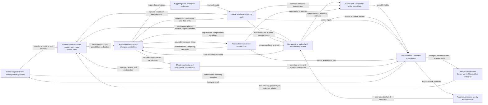

### C.40.OD:4 - Solution

**Characterize the situation. Formulate a worthwhile, attainable problem. State what would count as solving it and how to check a proposed solution against that criterion. Find or develop alternatives, compare them and secure the means for the chosen work. Carry it out and check its effect in use. Use the changed position to judge which problem is now worthwhile and attainable, or whether to stop.** A difficulty may first show up as a workaround, dependence on a helper or a cost borne elsewhere. A success can reveal a possibility that was previously out of reach.

Name what is being developed and who undertakes the work. For a system, show what it can now do under stated conditions (A.1). For an episteme, identify the subject matter, what can now be claimed or inferred about it and on what grounds (C.2.1). For a Method, show how a change to the reusable way of doing the work makes a result attainable across qualifying performances (A.3.1). For a discipline, show how its organized body of knowledge and its repertoire of practice sustain the change through later work (C.20). One undertaking can change several of these. An author can extend what a proof establishes without changing the research team’s capability. The team can also learn an existing proof technique while the proof stays the same.

For each connection identify the work, what performs it, what changes or is returned, and what the next performer needs in order to use the result. Assign formulation, search, comparison, choice, action and checking according to the capability, access and authority each operation requires (C.32.MWA.PP). An engineering unit can commission a supplier to construct alternatives and use a robot to test them. Either contribution can be obtained for one trial or retained in ordinary work. The authority to select an alternative or commit resources follows the actual assignment. Where cultural continuation matters, other carriers must be able to reconstruct and use the Method.

When the intended change is a capability, name the system expected to gain it and what it should be able to do on a later occasion with specified support (C.40.JD). That system can differ from the performer of the intervention. A service can produce a result for a client today while the client still needs the service for the same operation tomorrow.

The construction below is prospective. It describes transformations to arrange and the contributions on which they depend. It does not assert an obtaining E.18.NET network or make the following descriptions an exhaustive taxonomy of flows. Use the E.18 identity and change rules when selecting actual flow members. One described strand can require several members; two distinctions useful for the explanation can belong to one member.

#### C.40.OD:4.1 - Identify the growth and its receiving continuation

Name the subject of development, the situation that warrants attention, whose purposes it affects and the basis for characterizing its current condition. The performer, beneficiary, provider and payer may coincide. In research the subject of development can be the account of a phenomenon. The investigators choose and perform the inquiry.

Use C.40.OI and C.40.OC to bound and characterize the development inquiry. B.5.PI supplies the entry from an unnoticed or weakly understood difficulty in ordinary work. C.40.PC and C.40.CD help construct the problem and possible contribution when neither is settled. A discrepancy from a target is one entry; a newly accessible possibility, a dependence that has become costly, a changed environment or an unexamined limit after success can be another.

For each proposed change, say what becomes attainable, for whom, at what cost and with which uncertainty. “Become a learning organization” leaves the choice open. A team might obtain a qualified answer from an adviser, make that judgement itself or construct and improve its own way of making such judgements. The three results have different costs and call for different evidence.

Keep the present work that must continue visible. Development need not suspend useful operation, nor must every limitation be removed before the next contribution. Rest, consolidation, deliberate termination of one direction and protection from overload can preserve the conditions for subsequent development.

An epistemic question can supply the consequential situation. State what knowledge, understanding or way of obtaining results should grow and what new results or questions that growth could make attainable. A scientific explanation can be a worthwhile result before a practical application is found.

Distinguish three claims: the current result became better, the available way or understanding grew, and that growth changes which further problems can be handled. Explain each relied-on connection. A routine service improvement can end with the first claim; it need not be redescribed as open-ended development.

#### C.40.OD:4.2 - Formulate the problem and the inquiries needed to choose a direction

Keep ordinary work running where it remains useful. Preserve enough of a consequential episode to recover what was being attempted, the way used, its premises and what happened. The episode may be a failure, an unexpectedly successful response or a newly available means. Use a sufficient established account. When different live explanations would change the continuation, distinguish them before selecting the repair. For example, inability to supply a result can concern an inadequate Method, unavailable authority or an unlearned operation. Sending all three into a training programme would give them the wrong continuation.

Problematisation produces a formulation that can guide the search for a solution. Characterize what happened or what has become possible, for whom it matters, and under which conditions. Specify the change or gain in understanding sought and the evidence by which a proposed solution could be judged. If the present way breaks down, locate the failed premise or the observation needed to find it. A promising opportunity can also warrant a new problem. B.5.PI helps notice a difficulty and open an inquiry. C.40.OI bounds the inquiry. C.40.PC and C.40.CD support constructing and revising the problem and a possible contribution.

Use the thin ProblemCard in C.22.2:2.1 to check the formulation. The signal, affected situation and criterion should let an evaluator judge a proposed result without access to the formulator’s preferred solution. The formulator can also apply the criterion. Assign a separate evaluator when the assessment requires independence. Record a missing criterion or observation and obtain it before using the card to judge a solution. The formulation can be ready for a search while the method is still unknown.

A question asks for an answer. “Which field marks a revised record?” requests information that may help choose a processing Method. A research problem can itself be expressed as a question. “What is the smallest number of sessions compatible with these conflicts?” names a result to establish. A schedule attaining the number and a reason no smaller number suffices settle it. For an inquiry whose answer form needs construction, use B.5.QD:4.3 to name the objects, premises, allowed changes and what would answer it. A known, directly obtainable fact can be requested in ordinary language.

The formulation and available answers supply two different receiving operations:

- Direction construction compares worthwhile attainable changes for the subject, including their means, losses and dependence on others' contributions. It uses the understood difficulty and known possibilities, and identifies what further answer could change the choice.
- Method or knowledge inquiry searches, adapts, constructs or investigates the missing operation or relation. State what result would settle its present question and how that result could be used. The inquiry need not wait for a fully settled strategy when what can be done affects what is worth choosing. Once an adequate method is known, plan the executable work under A.15.2. Specify who will use the method, the result to deliver, its conditions of execution and how to check it. Once the performer has carried out the task, compare the actual result with the problem's acceptance criterion.

The returns matter. A technical inquiry that establishes a cheaper usable way can change the direction. A participant's objection can expose an unwanted result and change the problem formulation or proposed direction. An unavailable decision power can require a different undertaking. Do not freeze the formulation simply because one branch has begun work.

A **direction is ready for the next construction** when it specifies enough of the subject's changed possibilities and receiving conditions to distinguish ways of obtaining them. It need not settle every future question. “Use a consultant's answer”, “make this judgement with obtainable help”, and “organize and revise our own way of making this judgement” specify different results even when all three begin at the same failed project.

#### C.40.OD:4.3 - Construct the joins that make a developmental whole

Connect the formulated problem or selected inquiry to an obtainable epistemic or practical contribution. Then connect that contribution to the conditions of its use and to a further possibility opened by the changed position. A research result can change a problem formulation before a new application is built. A newly developed Method can make another result reproducible before anyone needs to acquire a new personal skill. A holder-development branch is selected only where the intended continuation requires it.

When changes to the obtaining way, the holder's capability and the conditions for performance depend on one another, use C.40.JD to construct those joins. Its return distinguishes delivered work, acquired capability, improved Method and retained help. When a qualified result is already obtained but the next worthwhile problem is unclear, use C.40.NP. Its return identifies what the changed position enables, including a justified local stop and preserved future possibility. These Methods can be used independently of this whole: one joins a present construction, the other starts from a result.

Do not require all branches. A theory-building inquiry may continue through a new question and a discriminating explanation without a training programme. A practitioner may use a developed way with an unchanged provision arrangement. A better AI configuration may remove a human operation while a different undertaking deliberately retains human mastery as an independent result. Keep the chosen end visible when changing its means.

The useful whole is an explained construction of transformations and their dependencies. A list of research, teaching, operation and management activities leaves the joins to be invented. For each consequential join, show what the supplying work returns, what the receiving work does with it and what condition makes that use possible. Adequate existing contributions are reused at their qualified scope. Obtain or develop only what is missing.

#### C.40.OD:4.4 - Connect the needed contributions to means, access and authority

For each proposed use of a Method, identify what the performer must receive from other work, which means it must be able to use, when it needs them, and who may authorize that use. Keep the supplying work and its result distinct from the receiving work: an expert examines a proposed experiment and returns a judgement; the researcher uses that judgement to choose or revise the experiment. The researcher's access to the apparatus and permission to conduct the experiment are additional relations. None can be inferred merely from the expert's availability.

Reuse conditions that already hold. For a missing condition, identify the work that could establish it and the participant able and entitled to undertake that work. Obtaining a usable input, reserving equipment, preparing a performer and securing agreement can require different actions and can return different results. Explain which receiving action each result makes possible. This construction belongs at every consequential connection, including problematisation, inquiry, practice, use and reconstruction by another carrier; it is not a final supply stage after the direction has been settled.

When existing contributors cannot perform the required work, identify which System, capability or Method must change. The development of a provider's knowledge, Methods or capability can be a dependency of another subject's development or an independently worthwhile undertaking for several later uses. Specify that growth and its further possibilities separately from routine work obtaining an input or arranging access. The same apparatus can remain in use while its measurement Method develops; replacing an apparatus or reserving its time alone establishes a different result.

The same performer can deliver a service, develop its Method and help another performer use it. These are distinct Work contributions without necessarily being distinct positions or organizational units. Compare their joint demand against capacity. Likewise, a research result can have its own scientific purpose while contributing to a product direction; the product does not become its only justification.

Embed the development undertaking in the surrounding activity. Preserve the ordinary results that cannot be displaced, identify what each development alternative would displace, and settle that choice with the resource owner. A project boundary, a Method boundary and an organizational boundary answer different questions. A residence coordinator can develop a way of running programmes and also run current cohorts; drawing two project branches has not doubled that person's available time.

#### C.40.OD:4.5 - Use and vary the connected description

The following drawing compresses the explained construction. Boxes identify described work, results and conditions; labelled arrows summarize prospective receiving connections. They do not assert generic world-side relation occurrences or one object passing through a lifecycle.

The drawing omits internal professional transformations, work that establishes access and authority, the multiplicity and timing of occurrences, participant signatures and most failure returns. Read those from the explanation and the Methods governing those details, not from arrow direction. For an E.18.NET claim, identify member flows and qualifying cross-flow relation occurrences under their governors. The proposed drawing does not supply that assurance.

Enter where a sufficient result is already available. An existing adequate Method can enter at the way and its receiving use; an established capable holder need not repeat learning. A missing source claim can open an inquiry without creating a whole training programme. Remove a branch only when its contribution is unnecessary or supplied elsewhere under compatible conditions. Keep an unresolved contribution visible instead of calling it done.

#### C.40.OD:4.6 - Compare alternatives that remain whole

Construct alternatives far enough to compare their attainable effects, costs and receiving uses. C.40.DC constructs possible directions, C.40.JF tests their joint reachability, and C.40.CU develops a reproducible way. Take the characteristics that matter to the affected roles and specify the constraints for acceptance and the improvements sought. For alternatives compared under common conditions, one dominates another when it does at least as well on every selected criterion and better on at least one. The remaining trade-offs call for a choice. A change of criteria can reveal a different problem and calls for a fresh comparison.

Keep promising alternatives in the archive. The portfolio contains the undertakings actually selected within the available capacity, time, authority and resources. A trial can earn its place by opening a direction that current performance alone would miss. Strategizing supplies a justified choice and commitments when the direction or means are unsettled (STR.18). Work on the chosen way and evidence from its use establish what changed.

Several routes can be live together:

- **A usable Method exists.** Obtain its result, use it, adapt it or develop the capability to perform it, according to the sought result. A course is not required when a qualified provider is the sufficient alternative.
- **The Method exists but is not feasible locally.** Obtain missing inputs or assistance, change access or allocation, or adapt the Method's contextual realization. If that exposes a poor direction, return to direction construction.
- **The proposed way is underdeveloped.** Use C.39 and C.40.CD/CU to construct and try it. Do not sell established provision of a result that the proposed way cannot yet supply.
- **A consequential knowledge claim is unresolved.** Use the applicable research practice. Independent research can also be worthwhile without an immediate product customer; give it its own result, conditions and resources.
- **The participant can perform the work only with continuing help.** Compare maintained support with a learning transition and a different division of work. Neither dependence nor independence is universally superior.
- **The current arrangement produces the result but blocks further development.** Compare changes to problem formulation, authority, learning opportunity and support, not merely faster execution of the same routine.

These branches can rejoin or reopen one another. They are not stages that every undertaking must complete in order. A fully formed local question can enter near its receiving use; a failed trial can return to the underlying purpose rather than repeat an unchanged solution.

#### C.40.OD:4.7 - Obtain the contributions that realize the construction

Use the first real receiving occasion to define a bounded realization. Which contribution will be made, by whom, with which means, on what terms, and what will its recipient then be able to do? Keep any uncertainty that the first attempt is meant to resolve visible. A charter, budget and meeting schedule can enable this work without being its intended result.

Identify the contributions needed for the first useful handover. If an existing service agreement and interface already cover a contribution, check its operating conditions and obtain it. Where a decision or a new commitment is needed, prepare the proposal with the participants who can make it. Voluntary participants must be able to decline or qualify their contribution. For a subject uncertainty, use [B.5.SD](https://github.com/ailev/FPF/blob/main/FPF-Spec.md#b5sd---construct-an-answer-through-substantive-discussion); for incompatible contributions, identify the conflict in result, burden, timing or authority and obtain a workable agreement, revised proposal or stop before relying on the combination.

When the proposal calls for agreement, discuss it in the participants’ own working terms and allow them to consult trusted advisers. Distinguish a misunderstanding from an objection to an accurately understood proposal. Revise the work, its conditions or the distribution of gains and losses when an objection warrants a change. Make the accepted contributions mutually knowable before relying on them. This work can change formulation and selection, not only implement a completed strategy.

An employer's proper authority, a professional obligation, a voluntary commitment and agreement to a service are different bases. A sponsor cannot settle all of them through one signature. When a needed contribution is unaccepted, outside the contributor’s authority or beyond available capacity, return to the relevant construction rather than hide it in the implementation plan.

When organizational realization is needed, obtain the joined contribution under its ordinary and exception conditions while preserving continuing service and concurrent commitments. Where a human capability is part of the promise, reuse sufficient current evidence about that person, later Work and permitted support. Obtain learning, practice, feedback and transfer results only for the needed acquisition, change or new use; an adequate supplied service can instead answer a promise that requires the result rather than the person's own capability. Engineered means need their own construction and qualification. The relevant subject practices retain the mechanisms and authority for these results. Observation and evaluation use the evidence required by the claim, not the mere completion of activities.

When the first attempt fails, locate what the result changes. Inadequate purpose, a wrong Method, a missing capability, unavailable means, a broken cross-flow connection and an unsupported success claim need different repairs. Preserve useful performed work and warranted results while changing the failed connection.

#### C.40.OD:4.8 - Make the way reconstructible in further use

Keep the decisions needed to operate the arrangement available at their point of use. Explain the purpose and strategy, which work supplies which result to whom, how the receiver uses it, and which means, access and authority the work requires. Keep this architecture explanation distinct from the effective commitments on which performance relies. Research questions, where present, specify what remains to be learned; Methods explain how recurring work obtains its results. These are different products. They need not become one document per named pattern, and their hierarchy need not reproduce the Library's framework hierarchy.

A local framework is justified when recurrent local practice needs a coherent language of Methods and their relations. Use E.4.DPF to construct it from the local problems and supplier results; identify variation, authority and the conditions that reopen an adaptation. Do not copy whole DPFs into every project. A contract or resource allocation is not replaced by an LPF, and a single project may need only a few adequately explained local instructions.

Carry a proposed Method into an actual work occasion with sufficient explanation, capability and means. Observe both conformity where it matters and the receiving result. When local adaptation works, distinguish what can be reused from what depends on local facts. When it fails, return to the responsible Method or architecture decision rather than treating failure as disobedience by default.

The typical network thus remains an aid to constructing and revising concrete practice. Its useful invariant is the recoverable connection among developing subjects, consequential problems, viable transformations, means and further development. Its layout and allocation can change.

#### C.40.OD:4.9 - Qualify continuation without promising infinity

Compare what the construction promised with what it made possible. An improved explanation, a new Method, a prepared performer and an accessible offer are different results. Use each result's own qualification and preserve the support on which it depends. The same observation can support one claim and leave another unresolved.

Show what the changed position makes newly attainable. Formulate a worthwhile next problem and name the means and support for a first attempt. For an inquiry, state what observation, argument or construction would establish its result. For a proposed practical change, identify who can choose it and what that choice depends on. A feasible continuation establishes an opportunity. To show self-development in action, identify the developing agent's own choice of problem, the work it initiated and the help it used. To establish growth beyond greater output on a familiar task, identify the new class of problems, the change in how candidates are generated or evaluated, or the improved means of making further improvements.

Finite observations qualify particular transitions and the means available for continuation. Stop an exhausted or harmful branch, preserve useful knowledge and take up another worthwhile problem when conditions warrant it. A provider's bounded contract can end while the recipient or independent cultural carriers continue.

